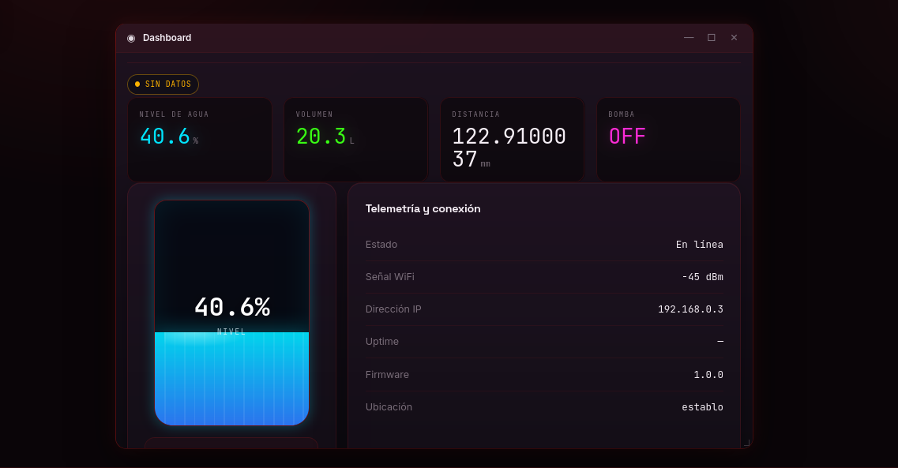
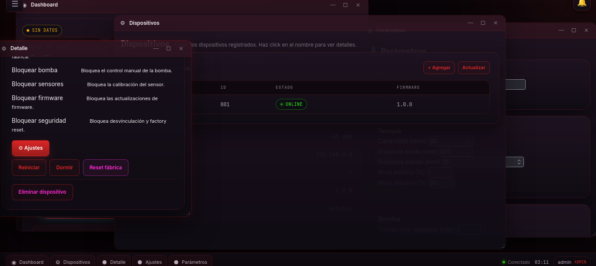

# DispWatter — Monitoreo de Agua con ESP32

Sistema IoT para el monitoreo y control de bebederos de ganado con ESP32, panel web en tiempo real y actualizaciones de firmware OTA.

## Capturas de pantalla

**Panel de control — Dashboard**



**Arquitectura del sistema**



## Características

- **Monitoreo en tiempo real** del nivel de agua con sensor ultrasónico HC-SR04
- **Control remoto** de bomba y relé a través del panel web
- **Actualizaciones OTA** (Over-The-Air) del firmware del ESP32
- **Sistema de usuarios** con registro y verificación por email
- **Permisos granulares** por dispositivo y rol
- **Historial de telemetría** con gráficas de nivel, volumen y distancia
- **Configuración del LCD** desde el panel web
- **Parámetros de tanque**: capacidad, distancias, niveles mínimo/máximo, relleno automático
- **Bloqueos de seguridad**: menú, WiFi, dispositivo, bomba, sensor, firmware
- **Temas claro y oscuro**

## Instalación

### Backend

```bash
cd backend
python -m venv .venv
source .venv/bin/activate
pip install -r requirements.txt
cp .env.example .env
# Editar .env con credenciales de base de datos y admin
python main.py
```

### Panel Web

El panel se sirve automáticamente junto con el backend en el puerto `3000`. También se puede servir de forma independiente:

```bash
python panel_server.py
```

O con un servidor estático simple:

```bash
python -m http.server 3000 --directory panel
```

### Firmware ESP32

```bash
cd hardware/esp32/main
pio run -e esp32dev          # Compilar
pio run -e esp32dev --upload # Flashear
```

O usar el script `flash.sh` en la raíz del proyecto:

```bash
./flash.sh                          # Compilar y flashear código local
./flash.sh --version v1.0.0         # Flashear una versión desde GitHub
./flash.sh --list-versions          # Listar versiones disponibles
```

## Actualizaciones OTA

Las actualizaciones se compilan automáticamente con GitHub Actions. Desde el panel:

1. Abre **Detalle del dispositivo**
2. Haz clic en **Actualizar firmware** para ver las versiones disponibles
3. Selecciona la versión y presiona **Instalar**
4. En el ESP32, presiona el botón **OK** para confirmar

## Botones Físicos

| Combinación | Acción |
|---|---|
| **OK + Arriba (2s)** | Entrar en modo OTA |
| **OK + Abajo (2s)** | Entrar en modo downgrade |
| **OK + Izquierda** | Volver al modo normal |
| **OK (corto)** | Confirmar acción |
| **OK (largo)** | Cambiar modo |

## Pruebas

```bash
./test.sh --all --save results
```

## Documentación

- [Arquitectura](ARQUITECTURA.md) — Diseño general del sistema
- [Circuito](docs/circuit.md) — Diagrama de conexiones del hardware
- [Montaje](docs/assembly.md) — Guía de ensamblaje
- [OTA](docs/ota.md) — Guía de actualizaciones de firmware
- [Botones](docs/buttons.md) — Guía de navegación del menú LCD
- [Cambios](CAMBIOS.md) — Registro de cambios del proyecto
